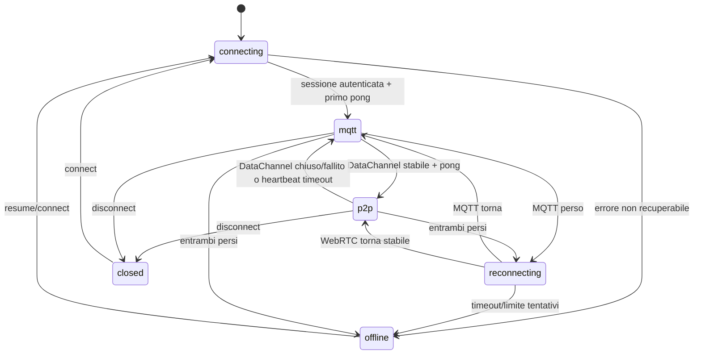

# Fallback e recupero

## Macchina a stati



`ConnectionStatus` è lo stato osservabile. `transport` indica il trasporto attivo (`"webrtc"`, `"mqtt"` o `null`).

## Perché non basta lo stato ICE

ICE può essere `connected` mentre il DataChannel è bloccato, il peer è in pausa o la rete è cambiata. P2PLink usa heartbeat applicativi cifrati:

- ogni `heartbeatIntervalMs` (default 5 s) invia un ping su **ogni** trasporto aperto;
- un pong aggiorna `lastPongAt` e l'RTT;
- un trasporto è sano se ha ricevuto un pong entro `heartbeatTimeoutMs` (default 15 s);
- WebRTC viene promosso solo se aperto da almeno `promoteAfterMs` (default 3 s) e con pong recente;
- dopo una retrocessione c'è un cooldown (default 5 s) per evitare flapping.

I ping sono consumati dal TransportManager: non attraversano RPC.

## Fallback

Quando WebRTC diventa inutilizzabile:

1. il TransportManager seleziona MQTT se sano;
2. le nuove richieste usano MQTT;
3. le richieste già inviate restano pending fino al timeout;
4. solo le richieste con `idempotent: true` vengono ritrasmesse sul nuovo trasporto, con lo stesso `request id`;
5. il server deduplica per identità + request id / idempotency key;
6. il client tenta di ristabilire WebRTC con backoff esponenziale e jitter.

Le richieste mutative interrotte **non** vengono ritentate automaticamente: falliscono con `OUTCOME_UNKNOWN` per non produrre doppie mutazioni.

## Riconnessione WebRTC

```text
delay = min(maxDelay, baseDelay * 2^attempt) * jitterFactor
```

Default: base 1 s, max 30 s, jitter 0,5, max 12 tentativi. Ogni tentativo crea un nuovo `epoch` e un nuovo `negotiationId`; il vecchio peer viene chiuso. Non viene riutilizzato lo stesso transport.

Un timeout di negoziazione (`requestTimeoutMs`) chiude un'offerta senza risposta e pianifica un nuovo tentativo.

## MQTT assente

Se MQTT cade ma WebRTC è sano:

- il traffico applicativo continua su WebRTC;
- lo stato resta `p2p`;
- MQTT.js tenta la riconnessione in background;
- quando MQTT torna, il TransportManager riprende gli heartbeat e il signaling è di nuovo disponibile.

Se il server ha perso la sessione (riavvio), invia un `session-reset` firmato; il client lo verifica e ristabilisce una nuova sessione con nuova bootstrap e nuove chiavi.

## Entrambi assenti

- Lo stato diventa `offline`.
- Le nuove richieste falliscono con `OFFLINE`.
- Le richieste pendenti vengono risolte secondo timeout e policy.
- Non vengono accodate indefinitamente in memoria.
- MQTT.js continua a ritentare; un `online`/`resume` del browser forza un probe.

## Lifecycle browser

`@p2plink/client` ascolta, quando disponibili:

- `visibilitychange` → al ritorno visibile esegue un probe immediato e, se WebRTC non è aperto, pianifica una negoziazione;
- `online` → probe e reset dei tentativi;
- `offline` → log.

I timer JavaScript possono essere sospesi da una WebView o da una tab in background. Al risveglio non si assume che gli heartbeat siano avvenuti: il probe e il timeout decidono lo stato reale.

`client.suspend()` chiude i trasporti, fallisce le richieste pendenti come `OUTCOME_UNKNOWN` e imposta `offline`. `client.resume()` esegue una nuova bootstrap e una nuova sessione. È utile per WebView, cambio rete e test manuali.

## In-flight e cambio trasporto

Esempio:

1. richiesta `data.add` inviata su WebRTC, `idempotent: false`;
2. il DataChannel cade;
3. la richiesta resta pending fino al timeout;
4. se arriva una risposta su MQTT, viene accettata (stesso `sid` + `cid`);
5. al timeout, il client restituisce `OUTCOME_UNKNOWN`, non un falso errore definitivo.

Con `idempotent: true`, il client può ritrasmettere la stessa richiesta su MQTT. Il server riconosce il request id e restituisce il risultato già calcolato, se presente.

## Anti-flapping

- WebRTC non viene promosso al primo pong: serve stabilità.
- Dopo una retrocessione, il cooldown impedisce la promozione immediata.
- Un trasporto che fallisce la decifratura ripetutamente viene segnalato come unhealthy e la negoziazione viene rifatta.
- Il client non cambia trasporto per ogni messaggio: la selezione avviene per stato, non per singola richiesta.

## Configurazione

```ts
limits: {
  heartbeatIntervalMs: 5_000,
  heartbeatTimeoutMs: 15_000,
  promoteAfterMs: 3_000,
  switchCooldownMs: 5_000,
},
webrtc: {
  reconnect: { baseDelayMs: 1_000, maxDelayMs: 30_000, maxAttempts: 12, jitter: 0.5 },
}
```

Per demo/test si possono ridurre, ma in produzione timeout troppo aggressivi producono fallback inutili su reti mobili.

## Osservabilità

`ConnectionSnapshot` espone:

- `status`, `transport`;
- `rttMs` e `rttByTransport`;
- `lastError` serializzato;
- `connectedAt`, `since`;
- `pendingRequests`;
- `sessionId`, `clientId`, `serverId`.

Il logger riceve eventi di trasporto, timeout, cambio trasporto, errori di decifratura e handshake. Non logga payload, token o chiavi.

## Risultati misurati

Nel benchmark locale (1/10/100 client, server separato, loopback):

- fallback rilevato in 2–3 ms con chiusura esplicita del DataChannel lato server (fino a `heartbeatTimeoutMs` in caso di perdita silenziosa);
- ripristino P2P in circa 4,7–5,5 s, dominato dal cooldown anti-flapping di 5 s e dalla promozione;
- RTT medio P2P 0,7–7,9 ms; RTT MQTT 61–85 ms.

Vedi [benchmark.md](benchmark.md).
