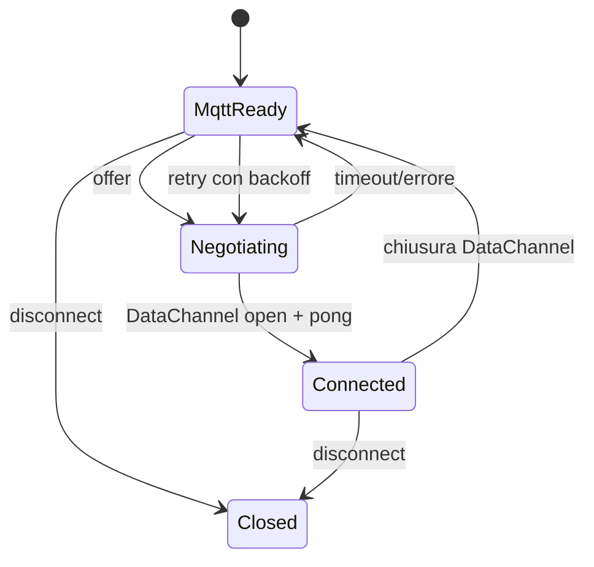

# Signaling MQTT

## Principio

Il signaling WebRTC usa lo stesso broker e la stessa sessione cifrata del traffico applicativo. SDP e ICE non vengono mai pubblicati in chiaro su topic dedicati: un broker compromesso non può riscrivere l'offerta o l'answer, né iniettare candidati.

Questa è una scelta deliberata rispetto allo schema classico "topic SDP separato". Vedi [decisions.md](decisions.md).

## Topic

```text
p2plink/v1/{tenant}/{serverId}/session/{clientId}/c2s
p2plink/v1/{tenant}/{serverId}/session/{clientId}/s2c
p2plink/v1/{tenant}/{serverId}/signal/{clientId}/s2c
```

- `{tenant}`: namespace infrastrutturale, default `default`. Non è multi-tenancy applicativa.
- `{serverId}`: server logico.
- `{clientId}`: client autenticato, 1–64 caratteri `[A-Za-z0-9._-]`.
- `session/c2s`: handshake JSON (`0x01`) e frame cifrati (`0x02`) dal client al server.
- `session/s2c`: handshake e frame cifrati dal server al client.
- `signal/s2c`: **solo** messaggi di controllo in chiaro, senza segreti: `session-reset`.

Il client pubblica esclusivamente sul proprio `c2s`. Il server pubblica sui topic `s2c` dei client.

## Perché il signaling è cifrato

Dopo l'handshake la sessione possiede chiavi `mqtt/c2s` e `mqtt/s2c`. Il client invia:

```json
{
  "type": "signal",
  "payload": {
    "kind": "offer",
    "negotiationId": "n-r4nd0m",
    "epoch": 0,
    "sdp": { "type": "offer", "sdp": "v=0..." }
  }
}
```

Come envelope cifrato sul topic `session/c2s`. Il server risponde con `answer` e `ice` cifrati su `session/s2c`.

Proprietà:

- integrità e riservatezza del signaling;
- il broker non può sostituire i DTLS fingerprint;
- il server accetta solo signaling con `tenant`, `serverId`, `sessionId`, `clientId` coerenti;
- `negotiationId` ed `epoch` impediscono l'applicazione di messaggi stantii o di una negoziazione precedente.

## Ruoli e collisioni

- Il **client è sempre l'offerer**.
- Il server è sempre l'answerer.
- Non esiste glare perché non ci sono due offerer simultanei.
- Ogni nuova negoziazione ha un nuovo `negotiationId` e un `epoch` incrementale.
- Un'offerta ricevuta dal server chiude l'eventuale peer precedente e crea un nuovo answerer.
- Un `answer` o `ice` con epoch diverso viene ignorato.

## ICE

- Trickle ICE tramite messaggi `ice`.
- I candidati possono arrivare prima della remote description: il transport li accoda (max 128) e li applica dopo `setRemoteDescription`.
- I candidati vengono inviati solo tramite la sessione cifrata MQTT.
- Non vengono usati topic retained.
- `iceServers` è esplicito nella configurazione: nessuno STUN pubblico implicito.
- Senza STUN/TURN funzionano solo percorsi diretti (loopback, LAN, NAT favorevoli).
- TURN può essere aggiunto tramite `iceServers` con credenziali fornite dall'applicazione.

## Ciclo di vita



- La connessione MQTT è la base: senza di essa non c'è signaling.
- Se MQTT cade ma WebRTC è sano, il P2P continua.
- Se WebRTC cade, le richieste passano su MQTT e la negoziazione viene ritentata con backoff e jitter.
- Il client usa un timeout di negoziazione (default: `requestTimeoutMs`) per non restare bloccato su un'offerta senza risposta.
- Dopo una retrocessione, un cooldown impedisce di promuovere immediatamente un P2P instabile.

## Session-reset

Il server non può decifrare frame di una sessione che non conosce (per esempio dopo un riavvio). Pubblica sul topic `signal/{clientId}/s2c`:

```json
{
  "v": 1,
  "kind": "session-reset",
  "clientId": "client-1",
  "sessionId": "session...",
  "reason": "unknown-session",
  "issuedAt": 1793058000000,
  "signature": "base64url..."
}
```

Il payload è firmato con ECDSA P-256/SHA-256 dalla chiave identità del server, con domain separation `p2plink/v1/control/session-reset`. Il client verifica la firma con la chiave pubblica ottenuta dal bootstrap, il `clientId`, l'eventuale `sessionId` e la freschezza (`issuedAt`). Un broker può ritardare, perdere o replicare un reset valido, causando un reconnect o un DoS, ma non può forgiarne uno nuovo né impersonare il server o decifrare la sessione. Il client interrompe la sessione, fallisce le richieste pendenti con `SESSION_RESET`/`OUTCOME_UNKNOWN` e tenta una nuova bootstrap + handshake.

## Topic wildcard server

Il server si sottoscrive a:

```text
p2plink/v1/{tenant}/{serverId}/session/+/c2s
```

L'`clientId` viene estratto dal topic e deve coincidere con il `clientId` firmato nel client-hello. Il nome del topic **non è** prova di autorizzazione: la prova è la capability firmata e l'identità crittografica.

## ACL

Vedi [broker.md](broker.md). In sintesi:

```text
user p2plink-server
topic read  p2plink/v1/+/+/session/+/c2s
topic write p2plink/v1/+/+/session/+/s2c
topic write p2plink/v1/+/+/signal/+/s2c

pattern write p2plink/v1/+/+/session/%u/c2s
pattern read  p2plink/v1/+/+/session/%u/s2c
pattern read  p2plink/v1/+/+/signal/%u/s2c
```

`%u` è lo username MQTT verificato. La demo assegna `username = clientId`.

## Limiti e abusi

- Dimensione massima dei messaggi di signaling: `maxFrameBytes` (default 256 KiB).
- SDP massimo 128 KiB; candidate massimo 8 KiB.
- Handshake rate-limited per clientId (5 token, refill 0,5/s) e numero massimo di handshake simultanei.
- Sessioni massime configurabili; oltre il limite il server rifiuta con `server-busy`.
- I messaggi di signaling non vengono conservati: un nuovo peer non vede offerte vecchie.
- Nessun topic retained per SDP/ICE.
